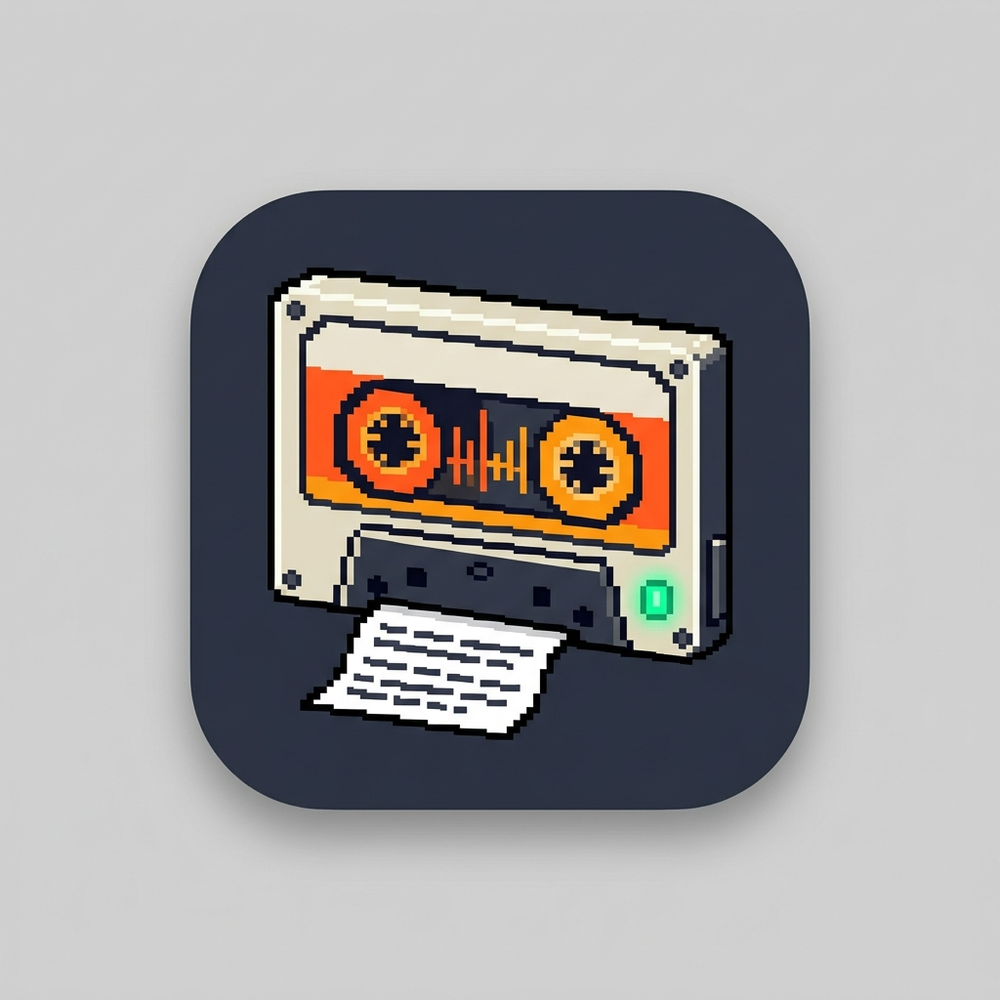

#  voicebox

Offline transcription, voice-overs and read-aloud for your coding agent. Runs entirely on
your machine, powered by [NVIDIA NeMo-Speech.cpp](https://github.com/NVIDIA/NeMo-Speech.cpp):
MagpieTTS for speech and Nemotron 3.5 for recognition.

- **Transcribe** audio and video files to text, subtitles or JSON, with speakers labelled.
- **Synthesize** a text or a markdown file into one audio file (wav, m4a or mp3) in a voice you choose.
- **Read aloud** a long text — a file, a web page, or something in the conversation — with `/voicebox:narrate`.

Nothing you transcribe, write or hear leaves your machine.

## Install

In Claude Code:

    /plugin marketplace add danilogr/voicebox
    /plugin install voicebox@voicebox-marketplace

voicebox needs [uv](https://docs.astral.sh/uv/), which launches it; if `uv` is not on the
`PATH` or in a standard location, set `VOICEBOX_UV` (used by the server launcher) to its
full path.

Restart Claude Code, then run `/voicebox:setup` once. It installs NeMo-Speech.cpp and its
two models (about 1.4 GB), downloads the grammars it reads numbers and abbreviations
with (9 MB), and shows voicebox's one-time telemetry notice. Transcription,
m4a and mp3 also need `ffmpeg` (`brew install ffmpeg` on macOS). voicebox works under
Antigravity too, as an MCP server; `/voicebox:narrate` is offered there as the `narrate`
prompt.

##  Transcribe

Meetings, interviews, voice memos, lectures, video clips: any format `ffmpeg` reads.

> *"Transcribe `~/Recordings/meeting.m4a` with speaker labels and summarise the decisions."*
>
> *"Make `.srt` subtitles for `~/Movies/demo.mp4`."*

`transcribe` starts a background job and answers at once with the output path and an
estimate; `job_status` reports progress, then a preview. Formats: text, JSON with word
timings and speakers, SRT, VTT. Speakers are labelled by default; a language can be named,
and the transcript translated.

##  Voice-overs

> *"Turn `~/notes/launch.md` into an mp3 in Sofia's voice."*
>
> *"Write this paragraph to `~/Desktop/intro.wav`."*

`synthesize` writes one audio file from pasted text or from a text or markdown file.
Markdown markup is not read out (list numbers and bullets included) and code blocks are
skipped; every other word is spoken, however long the text. The audio goes beside the
source file unless you say where, and an existing file is never overwritten. Pasted text
must name an output path. Like transcription it runs in the background, and `job_status`
reports how many chunks are done. Only one voicebox job runs at a time.

##  Read aloud

    /voicebox:narrate ~/docs/spec.md
    /voicebox:narrate https://example.com/post
    /voicebox:narrate

Reads in rounds of about ten sentences, so "stop" takes effect within seconds. It plays
sound and writes nothing; `synthesize` writes a file and plays nothing. Anything else
speaking through the same speech stack takes turns at the speakers rather than talking
over it.

## Tools and commands

| Tool | What it does |
|---|---|
| `transcribe(path, output_dir?, format?, diarize?, language?, translate_to?)` | Starts a transcription job |
| `synthesize(text? \| path?, voice?, output?, format?)` | Starts a job writing one audio file |
| `job_status(job_id?)` | Progress, result or failure of a job; recent jobs without an id |
| `read_aloud(text)` | Queues one sentence to be read aloud |
| `reading_status()` | How many sentences are still to be read |
| `stop_reading()` | Stops reading at once |

| Command | What it does |
|---|---|
| `/voicebox:narrate [file, URL or nothing]` | Read a long text aloud |
| `/voicebox:setup` | Install NeMo-Speech.cpp and the models |
| `/voicebox:telemetry [on\|local\|off\|--id\|notice]` | Show or change the telemetry setting; `notice` prints the first-run notice |
| `/voicebox:stats` | What voicebox has recorded about your own jobs |

## Settings

Environment variables, read when the server starts:

| Setting | Default | |
|---|---|---|
| `VOICEBOX_VOICE` | `John` | voice for reading aloud and for voice-overs |
| `VOICEBOX_ENGINE` | `nemo` | reading-aloud engine: `nemo`, `say` (macOS) or `command` |
| `VOICEBOX_COMMAND` | unset | the command the `command` engine runs; without one, `nemo` is used and a warning logged |
| `VOICEBOX_RATE` | engine default | reading-aloud rate, for engines that take one |
| `VOICEBOX_TRANSCRIBE_DIR` | the input's folder | where transcripts go |
| `VOICEBOX_TRANSCRIBE_TIMEOUT` | unset | seconds after which `job_status` calls a transcription possibly wedged; it does not stop the job |
| `VOICEBOX_UV` | found on `PATH` or in a standard location | full path to `uv`, used by the server launcher |
| `VOICEBOX_STATE_DIR` | `~/Library/Caches/voicebox` | jobs and the local telemetry store |
| `NEMO_HTTP_URL` | `http://127.0.0.1:8082` | the speech server |
| `NEMO_BIN` | `nemo-speech` | the server binary, when it is not on `PATH` |
| `NEMO_AUTOSTART` | `1` | `0` to run the speech server yourself |
| `NEMO_TTS_SEED` | unset | pins each voice's timbre across server restarts |
| `NEMO_TN_DIR` | `~/Library/Caches/speak-core/tn_configs` | the text-normalization grammars `/voicebox:setup` downloads |
| `NEMO_API_KEY` | unset | sent to the speech server when it needs one |

`NEMO_*` settings are shared by every plugin built on speak-core: whichever one starts
the speech server decides its arguments, so keep them identical.

## Limits

- One voicebox job runs at a time; a second request is refused with the running job's id.
- Voice-overs and read-aloud text are sent to the speech server one sentence at a time,
  because the speech model repeats and garbles words when one request holds several
  ([harness/performance.md](harness/performance.md)). A sentence over 250 characters is
  cut at its commas, with a short pause where it is cut. A word is still occasionally
  repeated.
- A voice-over is one WAV file (encoded from it for m4a and mp3), and a WAV file holds
  about 27 hours of audio: `synthesize` refuses text estimated to need more, which is
  about 1.2 million characters of prose.
- Text with no spaces between words (Chinese, Japanese) is cut at its full-width
  punctuation (`。`, `，`), and a run longer than a request with none is cut at the request
  size rather than at a word boundary.
- A voice-over request waits as long as the machine's pace needs, up to a fixed ceiling.
  A CPU-only machine is far slower than one with Metal or CUDA, and its voice-overs take
  correspondingly long ([measurements](harness/performance.md)). A request that times out
  fails the job; it is not retried.
- The speech server answers one request at a time. A sentence read aloud while a
  voice-over is being written waits behind that job's request, and one that waits too
  long is spoken by `say` instead of the neural voice.
- The telemetry setting is read when a session starts, and a job is recorded for the
  session that accepted it: a change applies from the next session.

## Privacy and telemetry

Audio, transcripts, the text you synthesize and file names never leave your machine.
voicebox reports anonymous usage data — which features are used, how long jobs take on
which hardware, why they fail, and the size and format of files — once you have seen its
notice. `/voicebox:telemetry off` stops it (an anonymous install count is still sent);
`DO_NOT_TRACK=1` stops everything. Every field is listed in [TELEMETRY.md](TELEMETRY.md).

## Also from this marketplace

 **walkie** lets your agent speak short status lines and listen to your answers: `/walkie:talk` to dictate a prompt, `/walkie:converse` to talk for a whole session. It shares voicebox's speech server and models, and the two take turns at the speakers.

    /plugin install walkie@voicebox-marketplace

## Development

    uv sync
    uv run pytest
    uv run ruff check .
    uv run mypy

The speech engine is [speak-core](https://github.com/danilogr/speak-core), a git
dependency. Operating rules are in [AGENTS.md](AGENTS.md); design in
[harness/architecture.md](harness/architecture.md), flows in
[harness/user-flow.md](harness/user-flow.md), measurements in
[harness/performance.md](harness/performance.md), conventions in
[harness/design-guidelines.md](harness/design-guidelines.md), and the file map in
[harness/layout.md](harness/layout.md).
