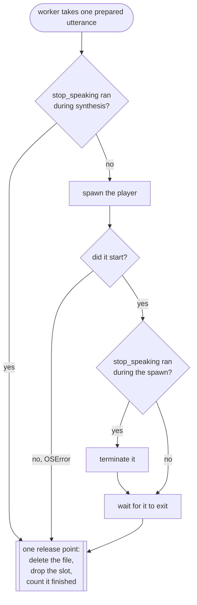

# Architecture

> System shape and the decisions behind it. Update after an agreed
> architectural change. Keep decisions with their rationale (the "why").

## Overview

`speak` is a Claude Code plugin that gives the agent a voice. It runs as an MCP
server over stdio and exposes five tools — `speak`, `stop_speaking`, `list_voices`,
`set_voice`, `speech_status` — so the model can say one short sentence out loud at the
moments where a voice beats scrollback. Its single responsibility is turning a sentence
into audible speech without ever blocking the agent and without letting two utterances
overlap.

It also hears, unconditionally. A sixth tool, `listen`, records the user and
returns a transcript, and the `/talk` slash command dictates a prompt instead of
typing it. There are therefore two entry points into the same code: the long-lived
MCP server (`__main__`) and a short-lived one-shot process (`talk`) that a slash
command runs and whose stdout is injected into the user's message. Both transcribe
against the same shared speech server the supervisor already manages.

## Components & boundaries

- **`__main__`** — the composition root for the MCP server. Reads the environment,
  builds every other component, and starts the transport. It must not contain speech
  behaviour; the only logic it owns is which components to build at all, in
  `build_ears` and `build_supervisor`, which `tests/test_composition.py` covers. Voice input added a second entry point, so the
  boundary rule now names both: `__main__` and `talk` are the only modules that read
  this plugin's configuration from `os.environ`, and neither installs a log handler
  itself — both call `runtime.configure_logging`. One other module touches the
  environment at all: `engines.say` reads `LANG` to filter `say -v '?'` by locale,
  which is the platform's setting rather than the plugin's configuration.
- **`config`** — the settings every plugin reads the same way, each a frozen dataclass
  built from a mapping: `ServerSettings` (the shared speech server, from unprefixed
  `NEMO_*` variables, plus the shared state directory) and `VoiceSettings` (engine,
  voice, pool, rate, cap and command, read under the prefix the plugin names).
  Unparsable values fall back to defaults with a warning. It must not read the
  environment itself.
- **`settings.Settings`** — this plugin's settings: a `ServerSettings`, a `VoiceSettings`
  read under `SPEAK_`, and the listening and transcription settings, under the same
  rules.
- **`text.normalize`** — collapses whitespace, enforces the length cap at a word
  boundary, rejects empty input. Pure; no I/O.
- **`engines`** — a `Protocol` and three implementations (`say`, `nemo`, `command`).
  An engine turns a sentence into an `Utterance`: a command, its arguments, and an
  optional async cleanup. Engines must not play audio or manage processes themselves.
  In every engine the text is an argv element and is never interpolated into a shell.
- **`queue.SpeechQueue`** — owns playback. Exactly one child process runs at a time.
  `enqueue` is synchronous and returns the number of utterances ahead; a single worker
  task drains the queue. `drain()` waits until nothing is queued, being synthesized, or
  playing, and is part of the `Queue` protocol because `listen` opens the microphone
  only once the speaker has finished. It must not know which engine produced an
  utterance. With a speaker lock it waits for the speakers before each player starts;
  a `stop()` ends that wait at once.
- **`speaker`** — the machine's speakers, claimed for one utterance at a time across
  processes: an `ExclusiveLock` (not re-entrant) in the shared state directory, plus a
  `speaker-waiting/<pid>` marker per waiting process. It must never silence speech: a
  directory it cannot use is a warning and an uncoordinated utterance.
- **`supervisor.NemoSupervisor`** — starts, shares, and stops the local speech server.
  It must not synthesize or play anything.
- **`server.create_server`** — the transport layer. Defines the tools inside a
  factory that closes over its dependencies, so there is no module-level mutable state
  and tests can build a server over fakes. It must not contain speech logic; it
  normalizes, delegates, and formats the reply. `listen` is defined only when the
  factory is given an `Ears`, which bundles the recorder, the transcriber, the
  microphone lock, the capture limits and the recording cue into one presence check.
- **`cue`** — the three sounds that bracket one recording: open, close, and the error
  tone that replaces the close when nothing was captured. Played through the resolved
  player with the same detached-spawn helper the speech queue uses. It must not know
  why the microphone is opening, and it must never fail a recording: a missing sound
  file, a missing player or a non-zero exit is a debug log and nothing else.
- **`player`** — resolves one command that plays a WAV, per platform, from the binaries
  actually present. Pure apart from the injected `which`, so the search is testable on
  any machine. Used by both `cue` and the `nemo` engine, which are the two places that
  need to make sound from a file.
- **`capture`** — the microphone. `SilenceTracker` is a pure state machine fed block
  energies and decides when an utterance has ended; `MicrophoneRecorder` is a thin
  shell that opens a `sounddevice` stream and feeds it. The split is what lets every
  capture path be tested without audio hardware.
- **`engines.asr`** — transcription over the speech server's OpenAI-compatible
  route. It must not record anything.
- **`miclock`** — one holder at a time for the single microphone, elected the same
  way the speech server's start lock is. It must not know what the microphone is for.
- **`runtime`** — what every entry point builds the same way: logging, the health
  probe and the shared server's supervisor (`supervisor_for`). It installs the one log
  handler, on stderr, on both the plugin's logger and the core package's, and is the
  only module that installs one.
- **`listening`** — what both of this plugin's entry points build the same way for
  listening: the capture limits, the microphone, the cue and the transcription timeout.
- **`talk`** — the `/talk` one-shot: hold the shared server for the life of the
  process, record, transcribe, print. It is the only module besides `__main__` that
  reads the plugin's configuration from the environment, and the only one where
  printing to stdout is the point.
- **`transcribe`** — file transcription. `service` holds the two tools' logic,
  `probe` and `prepare` read and convert media, `jobs` keeps one JSON record per
  job, and `worker` is the detached process that owns a job end to end. It shares
  no state with the speech server: a transcription cannot stall speech.
- **`exclusive`** — one holder at a time across processes, elected by an atomic
  `mkdir`. `MicLock` and the transcription lock are both instances of it.

Components communicate by direct async call. The only indirection is the supervisor's
coordination between separate session processes, which happens through the filesystem —
and the microphone lock, which coordinates the same way for the same reason.

## Nothing leaves the queue without being released

Every utterance the worker takes holds two things: a slot in `size`, and — for `nemo` — a
temp WAV on disk. Both are released in one place, so no exit path can skip it.

Two properties hold this together, both structural rather than remembered:

- **In flight is a reference, not a tally.** `_ahead` holds the utterance being prepared,
  `_inflight` the one the worker has taken, and `size` reads those references. A task
  cancelled before its first step never runs its body at all, so a counter released by a
  `finally` inside it leaks; a reference the caller clears cannot.
- **Dropping the slot is nested inside deleting the file.** The delete is itself an
  `await`, so a worker cancelled mid-delete may leave the file behind. The inner `finally`
  still drops the reference, because a queue stuck at `size` 1 would refuse every later
  `listen` for the life of the process.

An utterance prepared ahead that never reaches playback is released by the worker's own
`finally`, which cancels the prefetch and deletes whatever it produced.

The release point is also where each utterance's outcome is reported, exactly once:
`ok`; `discarded` when nobody heard it (a stop before or during the spawn, or while it
waited or was prepared); `interrupted` when a stop landed while it was audible, which
the generation re-checked after the player exits is what tells apart; and `failed`
when synthesis failed, the player would not start, or it exited non-zero on its own.
A player that a stop terminated exits non-zero too, so the generation is checked
before the exit code.

## Data model

Almost nothing is persistent.

- **Session state** (in memory, per process): the active voice and rate, whether the
  voice is re-rolled per utterance, the warmup task, and whether this session has
  registered with the supervisor. Claude Code runs one server process
  per session, so this is already isolated from every other window. Deliberately never
  written to disk.
- **Speech queue** (in memory, per process): utterances waiting in a deque, the one
  being prepared, the one the worker has taken, and the running child process. The
  last three are references rather than counts — see above. Two counters go with
  them: how many utterances have finished, and a generation that `stop` bumps to
  invalidate work already in flight.
- **Shared server state** (on disk, per machine), under the shared state directory
  (`<cache>/speak-core`, or `SPEAK_CORE_STATE_DIR`):
  - `clients/<pid>` — one empty file per live session. Source of truth for whether the
    speech server is still needed.
  - `server.json` — the running server's pid, port, and start time. Source of truth for
    what to stop.
  - `starting/` — a lock directory. Its existence means a session is mid-start; its
    mtime dates the attempt so an abandoned lock can be taken over.
  - `speaker/owner` — the pid of the process playing an utterance. Its directory is the
    lock, reclaimed when its holder has died.
  - `speaker-waiting/<pid>` — one empty file per process waiting for the speakers.
- **Plugin state** (on disk, per machine), under `SPEAK_STATE_DIR` (`<cache>/speak`):
  - `mic/owner` — the pid of the session currently recording. Its directory is the
    lock; the file says who holds it, so a lock left by a dead session is reclaimed.
  - `transcribe/`, `transcriptions/` — background transcription jobs and their output.

Voice input is not persistent by default. A recording lives in memory as WAV bytes for
the length of one transcription and is discarded. It is written to disk only when the user
turns recording on (`record: true` in the telemetry config), in which case each recording is
kept locally beside its utterance row so a user can later train a model on their own voice.
Recordings are never uploaded under any setting — the server schema has no column for them.

## Telemetry

`speak/telemetry/` is a self-contained package the rest of the plugin only reaches
through two seams: the queue's `on_finish` callback (one `UtteranceOutcome` per
utterance that leaves it) and a `TelemetrySession` handed to `create_server` and to
`talk.dictate`. Neither the queue nor the server knows what a `TelemetrySession`
does with what it is given, matching the existing rule that the queue must not know
which engine produced an utterance.

- **`consent.py`** — the switches and the persisted install id, read from a config
  file under the OS's per-user config directory, never `SPEAK_STATE_DIR`. A cache
  directory the OS may clear must not be the thing that silently re-enables
  telemetry someone switched off.
- **`machine.py`** — the one-time hardware probe (CPU, RAM, acceleration backend),
  cached in the config file and re-probed only when the plugin or OS version
  changes. Every source is cheap (`platform`, `sysctl`, `/proc`); a probe that fails
  or overruns its budget yields `"unknown"` rather than blocking.
- **`schema.py`** — `RowTable` and `TelemetrySchema`: what the store and shipper need to
  know of a plugin's tables. Both are table-agnostic, so a plugin whose rows are jobs
  uses the same code as one whose rows are utterances.
- **`contract.py`** — this plugin's schema; a test checks its column lists against the
  SQL, including every `-- LOCAL` column.
- **`store.py`** — the local SQLite database, built from the plugin's schema
  (`contract.SCHEMA`: `speak-telemetry`'s `contract/v1/schema.sql` and the column lists
  in `contract.py`). It is the outbound queue as well as the local
  record, so there is one mechanism rather than a database plus a spool file. A
  row is in the backlog while both `shipped_at` and `rejected_at` are NULL; a
  session while its `shipped_at` is NULL, which every update to the row clears, so a
  session that shipped when it began ships again with its `ended_at`. `seq` is
  assigned inside the INSERT, from the session's highest so far: the server and a
  transcription worker write to the same session from two processes, and only a
  statement under SQLite's single write lock cannot hand both the same number.
  `PRAGMA foreign_keys = ON` is set on every connection this module opens, matching
  D1's unconditional enforcement in production.
- **`session.py`** — turns queue outcomes and listen/talk attempts into stored rows.
  Every public method catches its own failures: a dead telemetry backend has to be
  indistinguishable from a healthy one.
- **`wiring.py`** — composition shared by `__main__` and `talk`, the same role
  `listening.py` plays for capture and cues: consent, the machine probe, and the
  `installs`/`sessions` rows a `TelemetrySession` is built from.
- **`ship.py`** — projects the current install's backlog of the schema's row table to
  the wire format (dropping every local column) and POSTs it in chunks, off the hot path: chunks of rows
  first, each carrying the sessions its rows belong to, then any changed session no
  chunk carried, on its own. Takes an injected transport. A `429`, a `5xx` or an
  unreachable server leaves the rest unshipped for the next session to retry, which
  is the entire retry mechanism; a `400` sets that chunk aside and the run goes on,
  because a payload the server refuses will be refused again and would otherwise
  hold back every row behind it. Rows are set aside with `rejected_at`; sessions
  refused on their own are marked sent.
- **`ping.py`** — the anonymous install ping (see the decision below). Whether one is
  due is a file read, made before `wiring.build` can create the consent file it
  consults; the request itself is a background task.
- **`report.py`** — `speak-stats`, plain SQL over the raw local tables.

Shipping and the ping run once per session, scheduled from `create_server`'s lifespan
rather than from `__main__.build()` itself: `build()` runs before the event loop
starts, so nothing there can call `asyncio.create_task`. `/talk` sends the ping
alongside its recording but never ships; the next MCP session ships its rows.

The lifespan's shutdown is what closes a session row, so `__main__.serve_stdio`
turns SIGTERM and SIGHUP into a cancellation that unwinds through it, as Ctrl-C does.
Left at their defaults, either signal kills the process before any of it runs. Once
that shutdown has run, `__main__.run` ends the process with `os._exit`: the MCP
transport reads stdin on a non-daemon thread no signal interrupts, and a normal exit
would wait for it until the host closed the pipe.

## External dependencies

- **`mcp`** — the official MCP SDK. Provides the stdio transport, protocol negotiation,
  tool-schema generation from type hints, and the client used by the end-to-end tests.
- **`httpx2`** — async HTTP for the speech server's `/v1/audio/speech`,
  `/v1/audio/transcriptions` and `/v1/models` endpoints and for the health probe. Its
  `MockTransport` lets the engine and the transcriber be tested without a live socket.
- **`sounddevice`** — the microphone binding, and the only native-wheel dependency
  here. Imported inside the recorder rather than at module scope, so a machine without
  a working PortAudio still runs the speech half of the plugin.
- **`uv`** — environment and dependency management, and the launcher. Must be
  resolvable at startup; `scripts/speak-mcp` finds it.
- **macOS `say`** — the default engine, and the fallback whenever the speech server
  cannot be reached. macOS-only, which is the one part of the plugin that is: on any
  other platform it is reported once at startup, and `SPEAK_ENGINE=nemo` or
  `SPEAK_ENGINE=command` is the way through.
- **A WAV player** — discovered, not assumed: `afplay`, PowerShell's `SoundPlayer`, or
  one of `paplay`, `aplay`, `ffplay`, `play`, `mpv`. Not a hard dependency; with none
  present the cues are skipped and the `nemo` engine speaks through the fallback rather
  than writing audio nothing can play.
- **The cue sounds** — synthesised by `scripts/make-cues.py` and committed under
  `src/speak/assets`. Not taken from the host operating system: the paths differ per
  platform, and shipping another vendor's audio is not ours to do.
- **NeMo-Speech.cpp** (optional) — a local neural speech server, installed by
  `scripts/install-nemo.sh` and managed by the supervisor. Not vendored: it is a
  per-platform binary plus both models, which is over a gigabyte of download. Sizes
  are in `performance.md`.

## Key decisions (with rationale)

- **An anonymous install ping goes out in every mode except `DO_NOT_TRACK`.** If
  `off` and `local` sent nothing, an install that opts out would be invisible, and the
  number of installs could not be known at all. The ping is `plugin_version`, `os` and
  `install`/`upgrade`, once per install and once per version, recorded locally in
  `ping.json` only after the server answers `2xx`. It is identical in every mode, so it
  never reveals that someone opted out, and it has no identifier, so it cannot be
  joined to an install's other data or to another ping. `DO_NOT_TRACK` is the one
  switch that means nothing is sent, and under it the ping module does not run at all:
  no request and no file. Rejected: an install id on the ping, which would make it a tracking beacon for
  people who said no; and keying install-versus-upgrade on anything but files already
  in the config directory, which would need a second identity to persist.

- **Sessions ship on their own, and a refused chunk is set aside.** A session row is
  written when the session starts and changes when it ends or learns its harness, long
  after its utterances may have shipped, and a session in which nothing was said had
  no utterance to carry it at all. So a session has its own local `shipped_at`, cleared
  by every update, and `ship` sends changed sessions with or without utterances. A
  `400` marks only its own chunk's rows `rejected_at`: they stay in the local store
  and in `speak-stats`, leave the backlog, and are never resent. The sessions carried
  with those rows stay in the backlog, since the fault may be in the rows alone; a
  chunk of sessions alone that is refused marks them sent, or they would be refused
  again every session. Rejected: retrying a
  `400`, which resends a payload the server already refused; and dropping refused rows,
  which would hide that it happened.

- 2026-09-21 — **File transcription is a tool backed by a detached worker.** A tool,
  because the failure it fixes is that Claude does not know a local option exists
  when it chooses how to transcribe, and only a tool description is in context
  then. A detached worker, because an hour of audio is nine minutes of work and an
  in-process task dies with the session or a plugin reload. The worker also writes
  the telemetry row, since the session that asked may be gone when the job ends.

  The tool claims the transcription lock and the **worker takes it over** as its
  first act, from the pid the job record names. The lock releases only for its
  holder; a handover from the tool could not happen before the worker existed, and
  a worker failing at once would release in that gap and leave the lock held.
  Conversion also happens in the worker, so the tool returns in milliseconds
  whatever the file.

  That claim is refused for any live holder, this process included: a session's own
  pid in the lock means a transcription is starting, not that this call already
  holds it, and one turn can carry three `transcribe` calls. The tool holds an
  `asyncio.Lock` as well, the way `listen` does, because the claim and the takeover
  are not one step, and checks it before waiting on it so a second call is refused
  at once rather than queued behind the first. The pid the spawn returned is written
  to a sidecar file the tool alone owns, never onto the job record itself - a
  read-modify-write there would race the worker writing that same record, which is
  exactly how a finished job's outcome once got reverted back to running. A worker
  that died before its own first write is therefore a crash at once rather than
  after a grace window, and both `start()` and `transcription_status` give the lock
  back whenever this session holds it and no job anywhere - not only ones this
  session started - is still running: what a worker that never took the lock over
  leaves behind, whichever session reconciles the job first.

  Telemetry reuses `utterances` with `source: "transcribe"` and five
  transcription-only columns, on contract v1 changed in place: there is one
  client, it waived compatibility with data already collected, and the change is
  additive on the wire. Rejected: an in-process `asyncio` task, which loses the
  job; the warm speech server's HTTP route, which has no diarization, timestamps
  or subtitle formats and would stall speech for every session for the length of
  a job; and a separate `transcriptions` table, which would rebuild every part of
  the shipping pipeline for a row that already fits.

- 2026-09-21 — **Voice input is unconditional; there is no `SPEAK_LISTEN`.** A plugin
  that ships `/speak:converse` and `/talk` cannot make them depend on a second switch
  the user has to find: turning on conversation mode and then discovering the ear was
  never wired is the failure the flag caused. The flag also decided whether the shared
  server loaded a transcription model, so removing it moved that question from
  configuration to capability: the supervisor always asks for the ASR model, and if the
  server will not answer with it, `ensure_running` kills that attempt and retries once
  without it. Speech therefore survives a missing or unloadable transcription model, and
  `listen` reports the problem and names the remedy. Rejected: keeping `SPEAK_LISTEN=0`
  as an opt-out, which leaves the flag in config, docs and tests for a case nobody asked
  for; and defining `listen` only when transcription is reachable, which makes the tool
  list depend on the environment and is harder to document than a tool that explains
  itself. `listen_enabled` stays in the telemetry row as a constant true, because it is
  part of the shipped row contract and dropping it is a schema migration, not part of
  removing a switch.

- **The when-to-speak policy lives in the `speak` tool description.**
  A tool description is always in the model's context at the moment the choice is made.
  Not a hook or a skill, neither of which can add a callable tool or is guaranteed
  to be read at that moment.

  The closing one-line recap is part of that policy and lives in the same place, for the
  same reason plus one more: a `Stop` hook receives a shell command and no view of the
  turn, so it can play a fixed sound but cannot say what changed. The hook types that
  could summarise — `prompt` and `agent` — are restricted to tool events. Only the model
  can write the recap. Nor per-user memory or `AGENTS.md`, which would make
  the plugin's own behaviour depend on machine-local state that does not travel with it.

- **The queue is serial and non-blocking.** `speak` returns immediately
  with a queue position, and exactly one child process runs at a time, so the agent
  never waits on playback and two quick calls never talk over each other. Rejected:
  awaiting playback, which stalls the agent for seconds per sentence.

- **The queue prepares the next utterance while one plays.** Synthesis costs about as much
  wall clock as the audio it produces, so a serial queue leaves the speakers idle for
  roughly half a spoken answer — a six-sentence answer measured 110 s that way against
  about 58 s pipelined. Depth is one, which is what preserves order for free: with never
  more than one utterance prepared ahead, the deque alone decides what comes next.
  Concurrent synthesis is not used: the speech server handles one request at a time, so
  three requests at once measured 1.05x against serial and gave up ordering to get it.
  A prefetched utterance holds a temp file of its own; releasing it is covered above.

- **Speech is synthesised whole, not streamed, because nothing streams it.** The local
  speech server buffers a complete clip before answering: "streaming synthesis is not part
  of this compatibility subset". The one path that streams audio out, its VoiceChat
  protocol, needs CUDA with 16 GB of GPU memory and has no CPU or Metal build, so it does
  not run on the machines this plugin targets. That is why the queue prepares whole
  utterances ahead rather than playing a stream, and the prefetch is not a workaround for
  something simpler that exists.

  Transcription is the other half and does stream — `WS /v1/audio/transcriptions/realtime`
  takes PCM as it is spoken and returns partial transcripts. It would shorten the gap
  between a user finishing and the transcript arriving, it runs on the same backend,
  and it fits behind the existing `Transcriber` protocol beside the HTTP one. Not adopted
  yet: the server is at v0.2.0 and says its interfaces may still change.

- **Voice and rate are per connection and never persisted.** One server
  process per session means a plain attribute is already isolated. Not a
  machine-wide voice file, which would leak one window's choice into every other.

- **The speech server is shared across sessions, not per session.** It
  holds roughly a gigabyte of resident memory, so one per window is untenable. Sessions
  are separate processes with no other way to see each other, so they coordinate through
  files: an atomic `mkdir` elects exactly one starter, each session leaves a pid file,
  and the last one out stops the server. Sessions that crash are pruned by pid so a lost
  window cannot pin the memory forever.

- **A cold start reuses the failure path.** When the speech server is
  unreachable the engine falls back to `say` and kicks off a start without awaiting it,
  so the first sentence is spoken immediately rather than after a several-second warmup, and
  every later sentence uses the neural voice. Not blocking the first utterance on
  the warmup, and starting the server eagerly at session start even when the session
  never speaks.

- **`--device auto` is always passed, and NeMo-Speech.cpp must be 0.2.0 or later.**
  `auto` is Metal on Apple silicon, where 0.2.0 synthesises this workload at about
  2x realtime against 0.07x on CPU (see `performance.md`). Before 0.2.0, MagpieTTS on
  Metal returns DC saturation instead of speech on M5-class Macs, so
  `install-nemo.sh` upgrades anything older and fails if an older copy still wins on
  PATH. Known limitation: with neither Metal nor CUDA, `auto` is CPU, where 0.2.0
  synthesis is slow enough that most sentences time out and fall back to `say`.

- **The `command` engine is a real feature.** It hands the sentence to any
  binary as its final argument, which covers piper, espeak, a script, or a remote
  speaker. It also happens to make the whole system testable without producing audio.

- **Dependencies are injected, and the server is built by a factory.**
  `create_server` closes over its engine, queue, and supervisor; the queue takes its
  process launcher, and the supervisor its spawn, liveness, and kill callables. This is
  what lets the suite cover the real code paths with no audio, no sockets, and no
  speech server. Not module-level singletons, which would force monkeypatching.

- **Deliberate tool failures raise `ToolError`.** The SDK withholds a raw
  exception's text from the model and sends a generic message instead, which would turn
  "unknown voice X; available: …" into unusable feedback. `ToolError` carries the
  message through.

- **A random session voice is resolved lazily, not at startup.** A
  speech server reports no voices until it has warmed up, so rolling at construction
  would always fall back to the default. The roll happens on first use and retries
  until the engine can answer. Per engine, the eligible pool differs: `nemo` uses every
  speaker the model reports, while `say` reports mostly novelty and legacy voices and so
  draws from a curated natural-voice list, narrowed to what is actually installed.
  `SPEAK_VOICE_POOL` overrides both and is taken at its word, so it also works with an
  engine that reports no names at all.

- **`stop_speaking` cancels synthesis already in flight.** A neural
  utterance takes seconds to synthesize, so without a generation counter a sentence
  stopped mid-synthesis would still be spoken once its audio arrived. The queue counts
  an in-flight utterance in its size and discards any whose generation changed.

- **Shutdown silences the queue before tearing down its worker.** The
  worker task owns the running child process, so cancelling it first drops the handle
  and leaves the machine talking after the session is gone. Stopping the queue first
  terminates the child while it is still tracked.

- **stdout is the protocol channel.** All logging goes to stderr, and the
  log handler is installed in one place. A stray `print` in library code desynchronizes
  the session, so library modules use `logging.getLogger(__name__)` only.

  `/talk` is the exception that proves it: its stdout is a prompt, not a protocol,
  and a failure there is printed to stdout as well as stderr. `commands/talk.md`
  branches on a line beginning `speak:`, and only stdout is certainly injected —
  whether a slash command's `!` capture carries stderr from a non-zero exit is not
  this plugin's to guarantee, and if it does not, stderr alone leaves the model an
  empty transcript under an instruction to act on it as the user's request. The
  prefix is what keeps the stdout copy from being read as speech.

- **`.mcp.json` launches `/bin/sh scripts/speak-mcp` rather than `uv`.**
  `/bin/sh` is an absolute path present on every target system, so the launch has no
  PATH dependency; the shim then finds uv via `$SPEAK_UV`, the PATH, and the locations
  uv's installers use. Not invoking `uv` directly, which fails under any parent
  that does not source the user's shell profile.

- **`listen` drains the speech queue before opening the microphone.**
  `speak` returns immediately by design, so a question is usually still playing when
  the next tool call runs, and without the drain the recording captures the agent's
  own voice. `SpeechQueue.drain()` exists for this and waits out synthesis as well as
  playback, and it waits as long as utterances keep finishing: one spoken answer is
  several of them, and each costs its synthesis as well as its audio, so a batch runs
  for minutes of legitimate work. Only a stall - nothing finishing inside a minute -
  ends the wait, and then the call is refused rather than recorded. Our own voice handed
  back as the user's answer is a fabricated request the model acts on, where a refusal
  can simply be retried.
  Not a combined `ask(question)` tool, which duplicates `speak` to buy only the
  ordering the drain already gives.

  `/talk` has none of this and cannot: it is a separate process with no handle on
  the session's queue, and a cross-process "is anything playing" signal costs more
  than the problem is worth. So a `/talk` started mid-sentence records the agent's
  voice, and `commands/talk.md` says to act on the result as the user's request.
  Documented in the README as a thing to wait out rather than engineered around.

- **Recording stops on silence, not on a keypress.** Neither entry point
  has a terminal: the MCP server owns stdin for the protocol, and a slash command's
  bash output is captured. There is no key to press, so silence is the only available
  end-of-turn signal. The gate is calibrated from the room's own ambient level over
  the first 300 ms rather than fixed, because a fixed threshold fails on a quiet
  microphone and in a noisy room alike.

- **ASR is served by the shared speech server, not a one-shot
  subprocess.** The model stays resident, so a transcription costs a request rather
  than a model load. The supervisor already elects one server per machine and tears it
  down when the last session leaves, so this is the existing lifecycle carrying a
  second model. Not `nemo-speech transcribe` per capture, which pays the load
  every time.

- **`--asr-model` is only added when listening is enabled.** A missing
  ASR model makes `serve` fail, which would take neural speech down with it. Gating
  the flag means a session that never listens cannot regress, and a session that opts
  in without running setup degrades to the `say` fallback that already exists rather
  than breaking.

  The cost of gating is a mixed machine: a session using neural speech without
  listening can win the start election and leave an ASR-less server running, which a
  listening session then finds. `listen` cannot tell that apart from an unpulled model
  by probing alone, so it names both causes rather than guessing one. It does not
  restart the server to fix itself — that would cut off whichever session is
  mid-sentence.

- **The microphone is arbitrated by a lock, and contention fails fast.**
  There is one microphone and any number of sessions; two recordings at once produce
  garbage in both. The election is the supervisor's, reused: an atomic `mkdir` on
  `mic/`, an owner pid in the file inside it, and a lock left by a dead session
  reclaimed by the next caller. Not queueing on the lock, which is worse than
  refusing — you would start talking and a window you are not looking at would take
  the words.

- **A second, in-process lock guards `listen` against itself.** The
  microphone lock is re-entrant by pid, which is what makes reclaiming a dead owner's
  lock possible but means it does not separate two calls inside one session: both
  would acquire it, and the first to finish would release the cross-process lock while
  the other was still recording. `listen` therefore also holds an `asyncio.Lock` and
  refuses a concurrent call rather than queueing it, so the answer is immediate.

- **A session registers with the supervisor at session start.** `/talk` runs as its own short-lived process, so without a warm server it
  pays a cold start on every invocation. Registering eagerly trades resident memory
  from session start for an instant `/talk`; the transcription model roughly doubles
  what the server holds, and `performance.md` has the figures. Sessions that do not
  enable listening register lazily instead.

- **A running speech server is never replaced, and the listening paths
  guard it twice.** A second server would overwrite `server.json` with a pid that
  cannot bind the port and orphan the first — the last session out would then stop
  the wrong process and leave a gigabyte resident.

  The two listening paths, the session warmup and `/talk`, call `reachable()` before
  `ensure_running()`. That check is liveness, not readiness: any HTTP answer means
  the port is taken, including the 503 of a server still warming up and the case of a
  server with no ASR model, neither of which may be replaced.

  Every path, those two included, is then guarded again inside `ensure_running`,
  which refuses when `server.json` names a live pid. That is the only guard on the
  TTS fallback (`__main__.start_speech_server`), which cannot make the first check:
  it starts the server from `except (HTTPError, OSError)`, so a 5xx or a synthesis
  timeout from a loaded server reaches it as "the server is gone". The pid check is
  the weaker of the two — it trusts `server.json`, so a record whose pid the OS has
  since reused reads as a live server — but guarding at the supervisor covers every
  call site at once, including future ones.

- **A cold start is reported as a cold start, not as a missing model.**
  `has_asr` answers False for any HTTP failure, so a server that is absent or still
  loading its models looks exactly like one served without `--asr-model` — and that
  message tells the user to run `/speak:setup` or restart another session, neither of
  which applies to a server that is eight seconds from ready. The server is started as
  the session opens, which makes that window the ordinary first run.
  Three pieces hold it together, and all three are required: `liveness()` answers
  ABSENT, STARTING or READY off one `/health` request, so both entry points can say
  "wait"; `ensure_running` probes on its early returns too, so a caller that finds
  another session's start already under way is handed a server that has answered and
  not merely one that has been recorded; and `listen` awaits its own session's warmup
  task. Readiness must not be inferred from `has_asr`, which answers False for any HTTP
  failure and so cannot tell a loading server from one with no model.

- **Transcription and liveness get different timeouts, and the
  transcription one is derived.** They are the same HTTP client but not the same
  wait: `/health` and `/v1/models` are localhost questions a live server answers in
  milliseconds, while a transcription is minutes of audio through a model. A single
  value cannot serve both: short enough for a probe will not transcribe a long
  recording, and long enough to transcribe holds `listen` for that whole time against
  a server that has wedged. A transcription that times out has already discarded its
  audio and blames the server rather than reporting that it gave up. So the probes take
  a short fixed timeout and the transcription timeout is derived from the configured
  recording cap, which is the only number that can bound it. A single raised constant
  breaks again the moment `SPEAK_LISTEN_MAX_SECONDS` goes up.

- **The queue re-checks the generation after spawning the player.** Checking only
  before the spawn leaves a window: between `stop()` releasing the current process and
  the new handle being recorded, an utterance can be stopped and still be heard. So the
  player is terminated the moment its handle is stored if the generation has moved
  since. It matters more with voice input than without: `listen`
  opens the microphone as soon as speech is meant to have ended, so an utterance that
  survives that window is recorded as well as heard.

- **Capture uses the `sounddevice` package rather than an ffmpeg
  subprocess.** It is the first native-wheel dependency here, and it is what makes
  voice input work off macOS; an `avfoundation` command line would not. The import is
  inside the recorder so a machine without a working PortAudio still gets speech.
  Not ffmpeg, which is one more thing to install and macOS-specific in this use.

- **A denied microphone arrives as silence, not as an error.** macOS opens the stream
  and delivers zeroed samples rather than raising, so there is no error to report and
  no way to distinguish a denied input from a muted one at the API. Both read as exact
  digital silence, which the deafness check treats as a muted device and names as such
  — permission is one of the causes that message lists. "Heard nothing" is reserved for
  a live microphone whose gate never opened, so the two remedies stay separate.

- **Whether anyone spoke is recorded by the tracker, not inferred from
  the terminal state.** `SilenceTracker.feed` checks the cap before the start
  timeout, so a recording of an empty room ends CAPPED rather than SILENT whenever
  the cap is the shorter limit — which `listen(max_seconds=8)` produces against the
  default 10 s timeout, and `max_seconds` is a parameter the model chooses. Treating
  CAPPED as speech would send room tone to the transcriber, and a transcription model
  given silence reliably emits a stock phrase: a fabricated answer for `listen`, and an
  injected prompt for `/talk`, whose command file says to act on it as the user's
  request. `Recording.has_speech` is therefore the fact that the gate opened, carried
  from the tracker. Clamping the start timeout to the cap is not enough: it narrows the
  window but still lands on CAPPED when the two are equal.

- **The microphone gate is clamped from above as well as below.**
  Calibration averages the first 300 ms, and nothing cues the user to wait, so
  talking straight away is the ordinary first run rather than a corner case. Without an
  upper clamp the gate lands near three times speech level, above anything a microphone
  produces, and the recording ends SILENT at the start timeout with nothing to show for
  it. A gate that is too low costs a longer recording; one that is too high loses the
  utterance and misdirects the user.

- **The default input is tried first, and a silent device is stepped
  over.** A stream of exact zeros is not a quiet room: a live microphone always carries
  a noise floor, so digital silence means a muted or disabled input. The OS default
  leads the search, so the device chosen in system settings wins on the first recording
  of every session; whatever answers is kept for the rest of the session, in memory
  only. Not persisting the choice, which would let a remembered device silently
  override the setting the user can see. A device is skipped only for exact silence,
  never for being quiet, or a pause would cascade through every input at ten seconds
  each.

- **Deafness is judged on its own window, not the calibration window.**
  CoreAudio hands over exact zeros while an input primes, and a Bluetooth microphone
  can take most of a second, so a 300 ms verdict rejects a working device that is
  merely slow. A device gets 1.5 s to produce anything; calibration then runs from its
  first real sample, which also keeps priming silence out of the ambient average — a
  gate diluted by zeros lands at the floor, and in a noisy room a floor-level gate
  opens on the room and never closes.

- **A word spoken before the gate arms starts the utterance.** Calibration runs for
  300 ms from the first real sample, and a one-word answer can be over before it ends.
  Averaging that voice into the ambient puts the gate above the speech it exists to
  detect, and the blocks are already buffered, so a block at or above the ceiling ends
  calibration instead: the gate takes the floor and the utterance begins there. The
  ceiling is the dividing line because no room delivers a block that loud, while a noisy
  room can still push the computed gate above it.

- **An empty capture ends on a different sound.** Recording stops on
  silence whether or not anyone spoke, so without a distinct tone the two are
  indistinguishable until the transcript fails to arrive. It replaces the closing cue
  rather than following it: "got it" then "that failed" is worse than only the second.

- **The cue sounds ship with the plugin, and the player is resolved.** A path into a
  system sound directory or a fixed player binary would tie playback to one operating
  system, while the microphone half is portable. Generated sounds are reproducible and
  carry no one else's assets; a resolved player keeps playback a subprocess, which the
  queue needs because it stops an utterance by terminating it.

- **Conversation mode is served as an MCP prompt, from its command file.** Claude Code
  reads `commands/*.md` itself; every other MCP client sees only what the server
  offers. The `converse` prompt serves that same file with its frontmatter removed, and
  takes its description from the frontmatter, so both have one copy whichever app asks.
  It is read once at startup, like the tool descriptions, and a checkout without the
  file loses the prompt and nothing else. It is offered only when `listen` is
  registered, because its instruction is to call it. `/talk` stays a slash command: it
  records before the user's message exists, and a prompt handler blocked on a
  microphone for seconds is what a client's timeout cuts off.

- **The microphone is cued open and cued shut, and the opening cue is
  awaited.** Nothing else told the user the microphone was open; `/talk` is the acute
  case, where you press enter and have no way to tell whether to talk now or in two
  seconds. The closing cue is not decoration either: recording ends on silence rather
  than on a keypress, so without it you never learn when the gate decided you had
  finished. Both are awaited to completion. That is a correctness requirement for the
  opening one and not merely tidiness: `SilenceTracker` calibrates its gate from the
  first 300 ms of audio, so a chime still sounding when the stream opens is averaged
  into the ambient level, sets the gate above what a voice reaches, and ends the
  recording in silence — the failure the upper clamp was added to survive. The clamp
  stays as the backstop; the cue is not allowed to lean on it. The end cue is awaited
  too, because the latency costs nothing next to the transcription that follows.

  The cues bracket the recording alone: they sound after the microphone lock is held
  and the speech server has answered, so a refused or unserviceable `listen` stays
  silent, and the closing one sounds when recording stops rather than when the
  transcript arrives. A cue is a convenience and a recording is not, so a missing
  sound file, a missing player, or a player that exits non-zero degrades to a debug
  log. Not playing the cue without awaiting it, which is exactly the
  calibration bug above; and a cue on only one end, which leaves the more useful half
  of the question — am I still being recorded? — unanswered.

- **Every process that plays speech takes the speaker lock around each utterance.** Two
  plugins mean two playback queues in two processes, and each queue's own ordering
  cannot see the other. The lock is per utterance, not per batch, so sentences from two
  processes interleave rather than one reading holding the speakers for minutes; a
  process that has just spoken and finds another waiting stays out of the race for a
  quarter of a second, which is what makes the turns alternate. Rejected: one queue per
  machine in a daemon, which is new infrastructure; and holding the lock for a whole
  batch, which makes a status line wait for a whole read-aloud.

- **Speech server settings are unprefixed and its state lives in a shared directory.**
  Whichever plugin starts the server decides its arguments for every plugin using it,
  so the settings that decide them (`NEMO_HTTP_URL`, `NEMO_API_KEY`, `NEMO_TTS_MODEL`,
  `NEMO_ASR_MODEL`, `NEMO_BIN`, `NEMO_AUTOSTART`, `NEMO_TTS_SEED`) cannot belong to one
  plugin, and `runtime.supervisor_for` builds the supervisor from them alone. Its start
  lock, pid record and client registry live in `<cache>/speak-core`, which every plugin
  resolves the same way, so the existing client registry is what lets one server serve
  several plugins. Those files' formats are a contract between speak-core versions: a
  change to one changes the directory's name. Rejected: a server per plugin, which
  doubles a gigabyte of resident memory; and prefixed server settings, which let two
  plugins disagree about a server only one of them starts.
