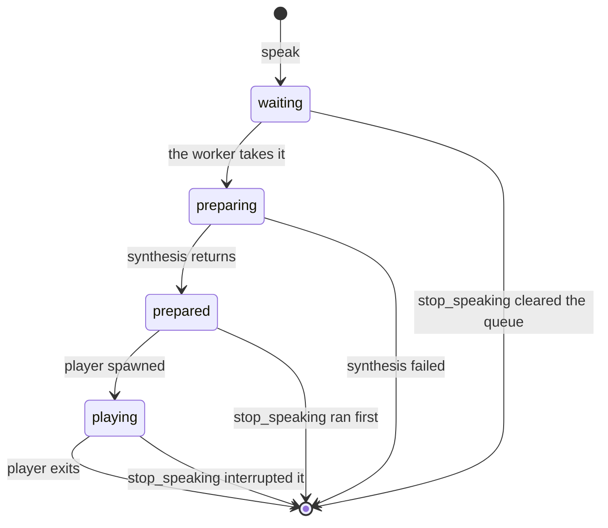

# User flow

> What happens on each path through the plugin, the states a recording moves
> through, and every branch that ends it early. Update when a flow or a terminal
> state changes. The *why* behind these choices lives in `architecture.md`;
> measured figures live in `performance.md`.

## Speaking

`speak` returns as soon as the sentence is accepted, so Claude never blocks on audio.

1. The text is normalised: whitespace collapsed to one line, capped at
   `SPEAK_MAX_CHARS` (400) at a word boundary. Empty after collapsing is an error.
2. The worker asks the engine to prepare it. For `nemo` that is an HTTP request for
   audio, written to a temp file; for `say` and `command` it is just a command line.
3. The player is spawned and waited on. The generation counter is checked before the
   spawn, after it, and once more after the player exits: a `stop_speaking` landing
   before or during the spawn discards the utterance, and one landing while it plays
   interrupts it. A player that exits non-zero on its own has failed.
4. Its temp file is deleted, and its outcome is recorded once: `ok`, `interrupted`,
   `discarded` or `failed`.



Every state in that diagram counts towards `size`, and `drain()` waits for `size` to
reach zero. That is the whole reason `listen` cannot open the microphone over our own
voice: an utterance is still counted while its temp file is being deleted, so there is no
moment where the queue looks empty but audio is still to come.

The worker keeps one utterance prepared ahead of the one playing, so synthesis costs
nothing but the first one:

```
one    [ synthesis ][==== playback ====]
two                 [ synthesis ]      [==== playback ====]
three                                  [ synthesis ]      [==== playback ====]
                    ^ prepared while the one before it is audible
```

Depth is exactly one — never two syntheses at once — so the deque alone decides what
comes next and order is preserved for free. `speech_status` reports each stage for a
caller deciding whether to wait.

A speech server that cannot be reached is not an error: the `nemo` engine logs it,
signals the supervisor, and the sentence is spoken by `say` instead. A missing player
binary is caught at spawn, logged, and costs only that sentence.

## One recording, state by state

`SilenceTracker` is fed one block energy at a time and decides when to stop. The cap
is checked before anything else, so it bounds every phase.

| State | Leaves when | Goes to |
|---|---|---|
| `WARMING` | any non-zero sample arrives | `CALIBRATING` |
| | `deaf_ms` (1.5 s) passes with only exact zeros | `DEAF` |
| `CALIBRATING` | `calibrate_ms` (300 ms) of audio **since the first real sample** | `WAITING` |
| | a block at or above the ceiling — louder than any room | `SPEAKING` |
| `WAITING` | a block reaches the gate | `SPEAKING` |
| | `start_timeout_ms` (10 s) passes | `SILENT` |
| `SPEAKING` | `silence_ms` (3 s) below the gate | `DONE` |
| any | `max_ms` (240 s) total | `CAPPED` |
| any | the caller sets the cancel event | `CANCELLED` |

Leaving `CALIBRATING` on time sets the gate to `ambient × 3`, clamped between a floor
of `0.01` and a ceiling of `0.05`. Leaving it early — on a block already at the ceiling —
sets the gate to the floor, because no ambient level was ever measured.

What each terminal state means to the caller:

| Terminal | Spoke? | What the caller does |
|---|---|---|
| `DONE` | yes | transcribe |
| `CAPPED` | maybe — read `has_speech` | transcribe only if it is set |
| `SILENT` | no | report that nothing was heard |
| `DEAF` | no | try the next input device |
| `CANCELLED` | maybe | the caller has already gone away |

`has_speech` is carried by the tracker, never inferred from the terminal state:
`CAPPED` is reached by an empty room whenever the cap is shorter than the start
timeout, and a transcription model handed silence returns a stock phrase that would
then be read as the user's words.

## Choosing an input

Tried in order, and the first one that is not `DEAF` is used and remembered for the
rest of the process:

1. `SPEAK_INPUT_DEVICE`, if set — and *only* that. A named device that is mute is an
   error, never a reason to record from one the user did not ask for.
2. The device already remembered by this process, if it is still present.
3. The OS default input.
4. Every other input, in enumeration order.

If all of them are `DEAF`, the result is `RecorderUnavailable` naming each one tried.
If none could even be opened, the first open error is raised instead. A binding too
old to enumerate devices falls back to recording from the default.

## `listen` — Claude asks, you answer

Ends the turn only when it has a transcript or an error.

1. Already listening in this session → refused, naming that fact.
2. The speech queue is drained, so the microphone cannot hear Claude. It waits as long
   as utterances keep finishing: a spoken answer of several sentences costs its
   synthesis as well as its audio, so a batch legitimately runs for minutes. Only a
   stall — nothing finishing within 60 s — ends the wait, and then the call is refused
   rather than recorded, because our own voice returned as the user's answer is worse
   than being asked to try again.
3. Any warmup started when the session opened is awaited.
4. Liveness, then capability: a server that is absent, one still loading its models,
   and one running without a transcription model each get their own message, because
   the remedy for each is different and wrong for the other two.
5. The microphone lock is claimed. Held by another session → refused, naming which.
6. Open cue, played to completion, then record, then the closing cue — or the error
   tone if nothing was captured.
7. No speech → the heard-nothing sentinel. Otherwise the audio is transcribed.
8. The lock is released on every path.

## `/talk` — you speak, it becomes the prompt

A separate short-lived process, so it can neither see nor drain the speech queue.

1. Voice input off → one `speak:` line and a non-zero exit.
2. It registers with the supervisor for the life of the process, so a standalone
   `/talk` cannot leave a gigabyte of speech server behind it. The install ping, if one
   is due, goes out alongside the recording and is abandoned rather than waited for.
3. If the server does not answer and autostart is off, that is reported rather than
   a server being started behind the user's back. Otherwise it is started.
4. Capture runs exactly as for `listen`, minus the drain.
5. Heard nothing → the `(heard nothing)` sentinel on stdout.
6. A transcript goes to stdout, which is the product: the slash command splices it
   into the prompt.
7. Any failure prints one `speak:`-prefixed line to **both** streams and exits
   non-zero. Never a traceback — stdout is read as the user's own words.

Every attempt leaves exactly one telemetry row, whatever ended it: `ok`,
`heard_nothing`, `refused` for a busy microphone, and `failed` for everything else,
including a server that is not there or will not start.

## Telemetry: the install ping and shipping

At the start of each MCP session, before the consent file can be created:

1. `DO_NOT_TRACK` set → no ping, no file, and nothing collected or shipped. Stop.
2. The ping is due unless `ping.json` already names this version: with no `ping.json`,
   it is an `install` when there is no `telemetry.json` either and an `upgrade` when
   there is; with an older version in it, an `upgrade`. This is the same in every
   telemetry mode.

Then, in the background, once the session's event loop is running:

3. A due ping is sent. A `2xx` writes `ping.json`; anything else leaves it due for the
   next session. `SPEAK_TELEMETRY_DEBUG` logs it instead and writes nothing.
4. In mode `on`, this install's backlog ships: utterance chunks of up to 100 rows,
   each with the sessions its rows belong to, then every changed session no chunk
   carried, on its own.

| Answer | Utterances in that chunk | Its sessions | The run |
|---|---|---|---|
| `202` | shipped | shipped, unless changed while in flight | continues |
| `400` | `rejected_at`, never resent | stay in the backlog | continues |
| `429`, `5xx`, unreachable | stay in the backlog | stay in the backlog | stops after retries |

When the session ends, by stdin closing or by SIGTERM or SIGHUP, the lifespan's
shutdown writes `ended_at`, which puts the session back in the backlog; the next
session ships it.

## The shared speech server

One per machine, reference-counted on disk under the shared state directory (`<cache>/speak-core`).

| Situation | What happens |
|---|---|
| `server.json` names a live pid | no spawn; the port is probed and the caller proceeds |
| another session holds the start lock | no spawn; the port is probed and the caller waits for it |
| neither | the lock is claimed, the server spawned, its pid recorded, the port probed |
| a session leaves | its client file is removed |
| the last client file goes | the server is stopped |

The lock is an atomic `mkdir`, so exactly one starter wins. A recorded pid that no
longer exists is reclaimed. Models are fixed when the server starts: a session that
wants transcription and finds a voice-only server cannot upgrade it, and since the
server only stops when the last client leaves, restarting one session does not help
while others are attached.
